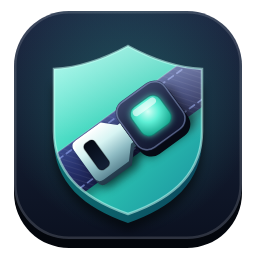
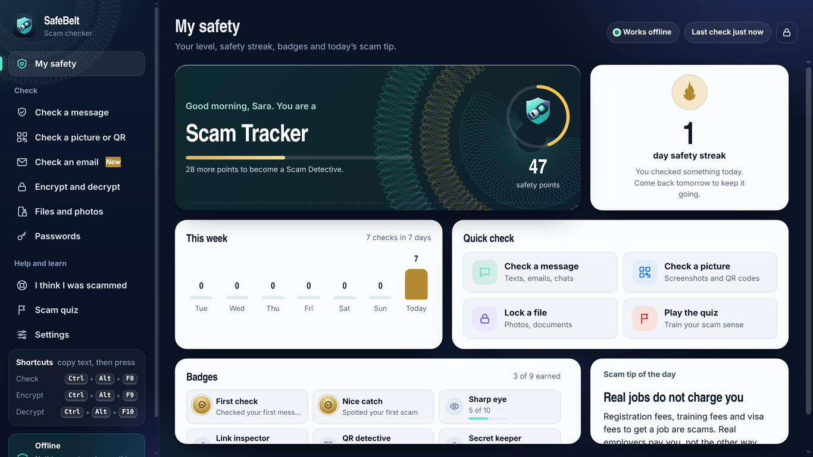
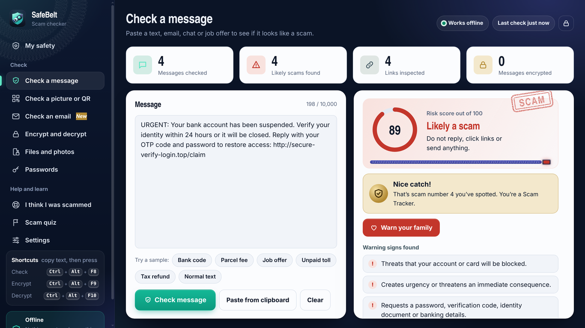

# SafeBelt

**A scam checker for Windows that keeps everything on your PC.**

Paste a strange message, link or email, or drop in a screenshot or QR code, and SafeBelt shows the scam signs it finds and what to do next. It also teaches scam spotting with quizzes you can play alone or with family and friends.

## Get SafeBelt

SafeBelt is coming soon to the Microsoft Store, for Windows 10 and 11 (64-bit).

[Get SafeBelt from the Microsoft Store](https://apps.microsoft.com/detail/9PK8KRFGQPND)

## What it does

- **Check messages, links and emails.** You get a risk score, every warning sign found, and the next step to take. It knows the scams common around the world, including in the Gulf and India.
- **Check screenshots and QR codes**, including fake "scan to receive money" codes.
- **Check saved emails** for fake senders and risky attachments.
- **Lock private text and files** with a password.
- **Learn:** scam quizzes, and a step-by-step guide if you think you were scammed.

## Privacy

- No account, no ads, no tracking.
- Nothing you check is sent to the internet.
- Moving your profile to a new PC uses only your own Wi-Fi.

Read the full [privacy policy](PRIVACY.md).

## Help

Email **safebeltsupport@gmail.com**. SafeBelt's scores are estimates: when in doubt, contact the company or person yourself, using a number or website you already trust.
